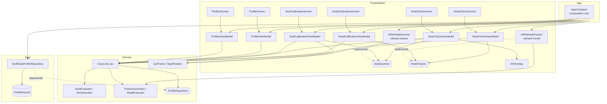
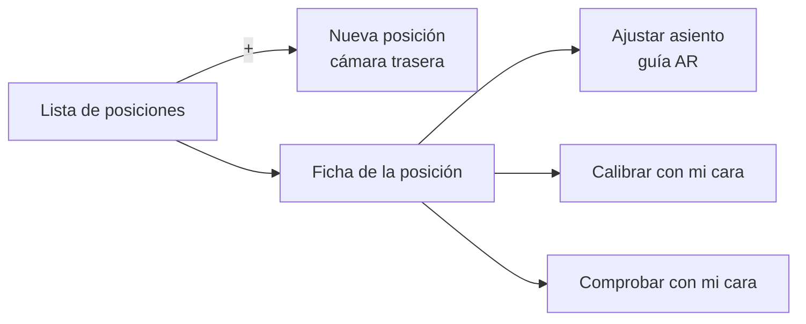
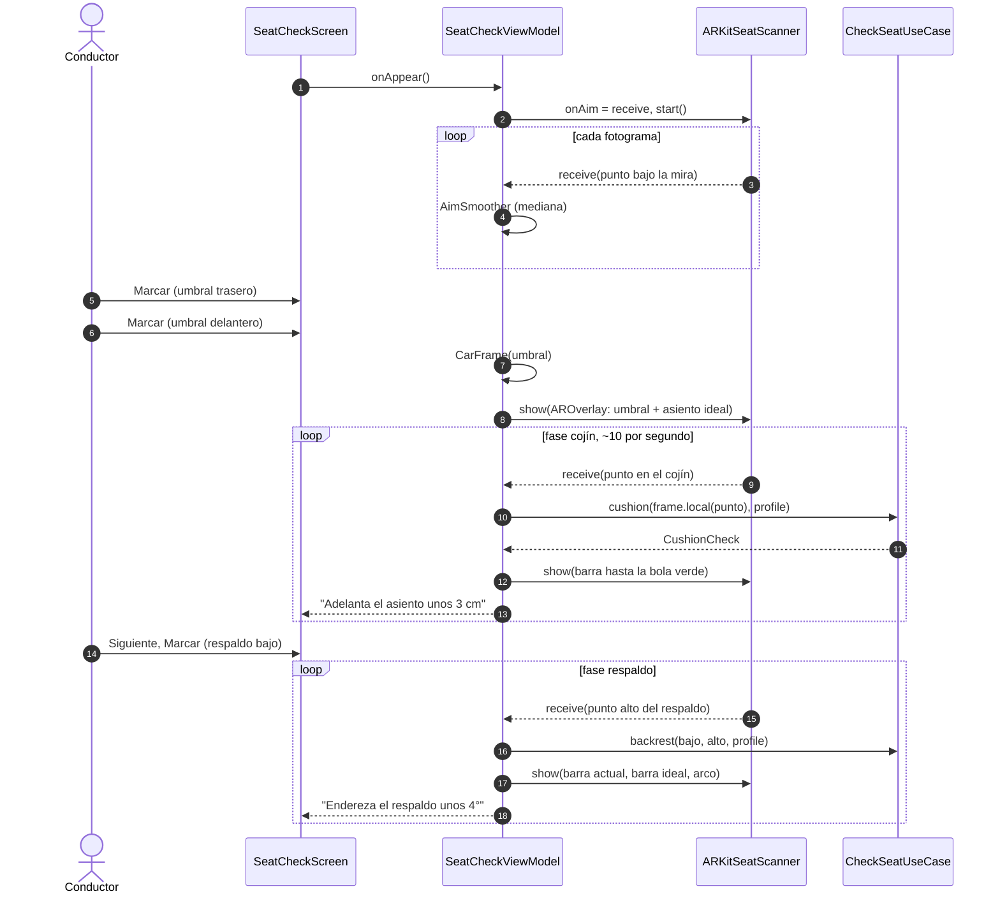

# Arquitectura

Clean Architecture con MVVM, igual que DrawPad
([ADR 0003](adr/0003-clean-architecture-mvvm.md)).

## Capas

| Capa | Importa | Contiene |
| ---- | ------- | -------- |
| Domain | `Foundation` | `Vector3`, `CarFrame`, `SeatLandmark`, `SeatPosition`, `SeatTolerance`, `CushionCheck`/`BackrestCheck`, `PostureSample`/`PostureMeasurement`, `HeadTolerance`, `HeadEvaluation`, `Adjustment`, `DrivingProfile`, `PositionError`, servicios (`SeatEvaluator`, `AimSmoother`, `PostureGeometry`, `HeadEvaluator`), `ProfileRepository`, casos de uso. |
| Data | `SwiftData` | `ProfileRecord`, `SwiftDataProfileRepository`. |
| Presentation | `SwiftUI`; `ARKit`/`SceneKit` solo en dos archivos | Pantallas, ViewModel, `SeatScanner`, `HeadTracker`, `AROverlay`, adaptadores de ARKit y simulados. |
| App | todo | `AppContainer`, `CarPositionApp`. |

## Navegación

Ninguna pantalla con cámara abre otra con cámara: así nunca hay dos sesiones
de ARKit a la vez.

## Secuencia: guía del asiento

## Pruebas

| Qué | Dónde | Cómo |
| --- | ----- | ---- |
| `CarFrame`, ángulos, evaluadores, mediana | `CarPositionTests/Domain` | Números a mano, incluido otro origen de ARKit y el auto en pendiente. |
| Casos de uso | `CarPositionTests/Domain/UseCasesTests` | `InMemoryProfileRepository`. |
| ViewModel | `CarPositionTests/Presentation` | `FakeSeatScanner.aim(at:)` y `FakeHeadTracker.emit(_:)`; se comprueba también el `AROverlay`. |
| Flujo completo | `CarPositionUITests` | App real con `-uiTesting` (cámaras simuladas). |
| ARKit y SceneKit reales | — | A mano, en el auto. |
