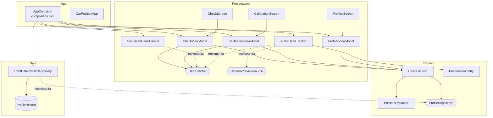
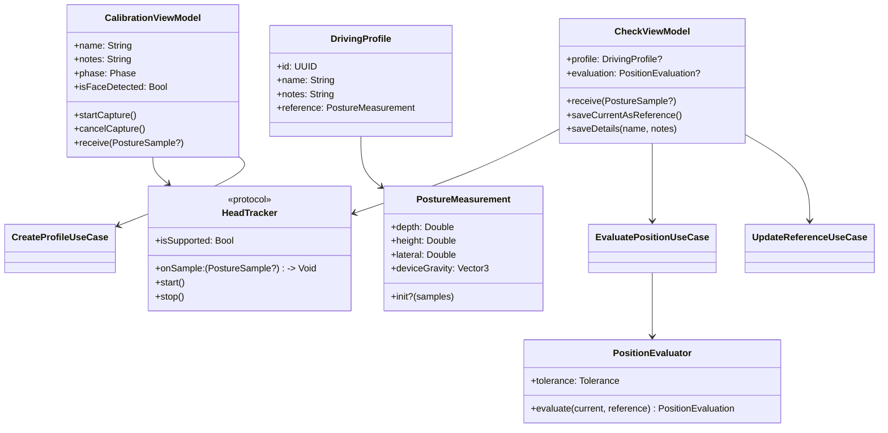
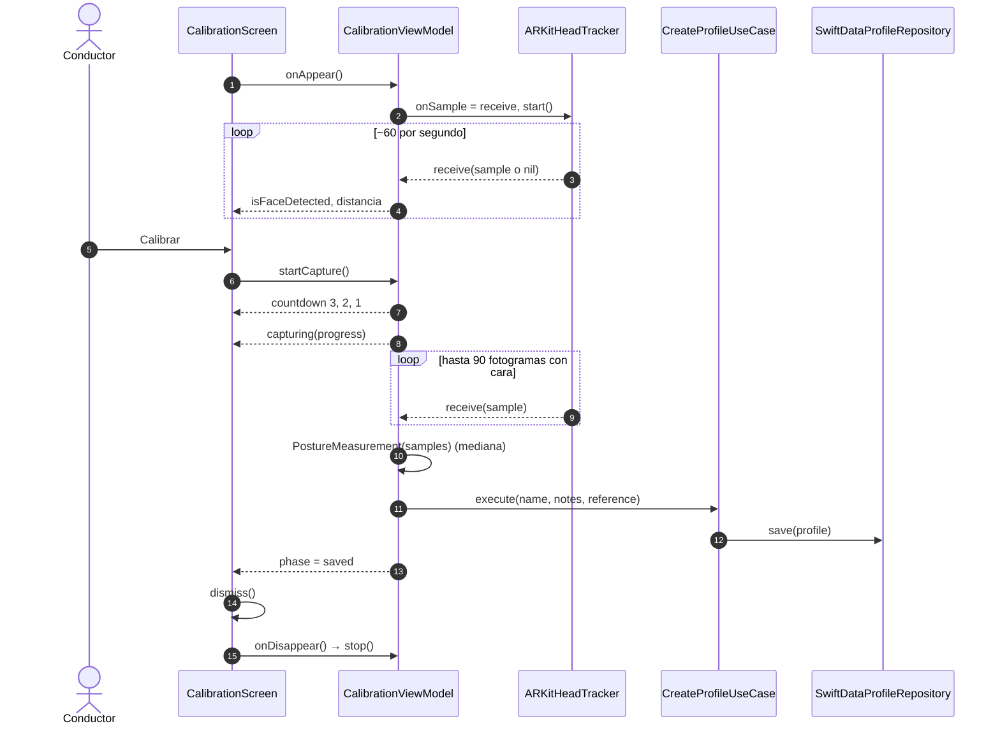
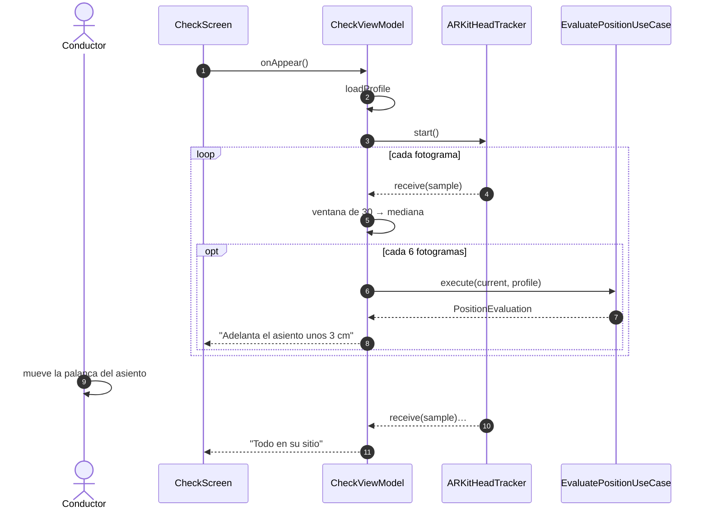

# Arquitectura

Clean Architecture con MVVM, igual que DrawPad
([ADR 0003](adr/0003-clean-architecture-mvvm.md)).

## Capas

Las flechas solo van hacia dentro: `Domain` no conoce a nadie; `Data` y
`Presentation` conocen el dominio; solo `App` conoce todas las capas.

| Capa | Importa | Contiene |
| ---- | ------- | -------- |
| Domain | `Foundation` | `Vector3`, `PostureSample`, `PostureMeasurement`, `DrivingProfile`, `Tolerance`, `PositionEvaluation`/`Adjustment`, `PositionError`, `PostureGeometry`, `PositionEvaluator`, `ProfileRepository`, casos de uso. |
| Data | `SwiftData` | `ProfileRecord`, `SwiftDataProfileRepository`. |
| Presentation | `SwiftUI`, `ARKit` (solo un archivo) | Pantallas, ViewModel, `HeadTracker`, `ARKitHeadTracker`, `SimulatedHeadTracker`, `CameraPreview`. |
| App | todo | `AppContainer`, `CarPositionApp`. |

## Clases principales

## Secuencia: calibrar

## Secuencia: comprobar

## Pruebas

| Qué | Dónde | Cómo |
| --- | ----- | ---- |
| Geometría, mediana, evaluación | `CarPositionTests/Domain` | Números a mano. |
| Casos de uso | `CarPositionTests/Domain/UseCasesTests` | `InMemoryProfileRepository`. |
| ViewModel | `CarPositionTests/Presentation` | `FakeHeadTracker.emit(...)` simula fotogramas. |
| Flujo completo | `CarPositionUITests` | App real con `-uiTesting` (cámara simulada). |
| ARKit real | — | A mano, en el auto. |
