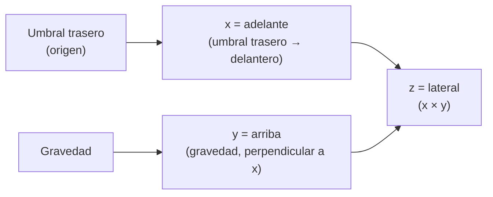

# Cómo funciona la medición

Decisiones: [ADR 0007](adr/0007-guia-ar-del-asiento.md) (asiento, cámara
trasera), [ADR 0008](adr/0008-camara-frontal-complemento.md) (cara, cámara
frontal) y [ADR 0009](adr/0009-comparacion-en-vivo.md) (comparación).

## 1. La mira (`ARKitSeatScanner`, `AimSmoother`)

En cada fotograma se lanza un **rayo** desde el centro de la pantalla contra
las superficies que ARKit reconoce (primero los planos detectados, si no una
estimación). El punto de choque tiembla unos milímetros, así que se usa la
**mediana** de los últimos 10 fotogramas.

## 2. El sistema del auto (`CarFrame`)

ARKit cambia de origen en cada sesión, así que nada se guarda en sus
coordenadas. Con los dos puntos del umbral (en la app, **pisadera**: la parte
de abajo del marco de la puerta) se construyen unos ejes **pegados
al auto**:



- `local(p)`: un punto del mundo de ARKit → coordenadas del auto (metros).
- `world(p)`: al revés, para dibujar el asiento ideal sobre el real.
- Como `y` se corrige para ser perpendicular al umbral, si el auto está en
  una pendiente todo gira junto y las medidas no cambian.

## 3. El asiento (`SeatPosition`)

```text
            backrestUpper ●
                         /
                        /  ← ángulo del respaldo (respecto a la vertical del auto)
                       /
        backrestLower ●
                      |
   ────────────────── ● cushionFront  (x: adelante/atrás, y: altura)
  umbral ●────────────────────────────● umbral
       trasero (origen)            delantero
```

- **Adelante/atrás** = `cushionFront.x`; **altura** = `cushionFront.y`.
- **Ángulo del respaldo** = `atan2(−Δx, Δy)` de la línea bajo → alto, en
  grados. Positivo = inclinado hacia atrás. El eje lateral se ignora.

## 4. La comparación (`SeatEvaluator`)

| Medida | Tolerancia | Si está por encima | Si está por debajo |
| ------ | ---------- | ------------------ | ------------------ |
| Cojín, `x` | 1,5 cm | Atrasa el asiento | Adelanta el asiento |
| Cojín, `y` | 1,5 cm | Baja el asiento | Sube el asiento |
| Respaldo | 2° | Endereza el respaldo | Inclina el respaldo |

## 5. Lo que se dibuja (`AROverlay`)

| Color | Significado |
| ----- | ----------- |
| Azul | El umbral (referencia). |
| Verde translúcido | El asiento ideal guardado (el "fantasma"). |
| Naranja | Lo que se mide ahora, si aún no coincide. |
| Verde | Lo que se mide ahora, cuando ya coincide. |

Durante el respaldo se dibujan la barra actual, la ideal (con la misma
longitud, desde el mismo punto bajo) y un **arco** de 15 cm de radio entre
las dos: el ángulo que falta.

## 6. Complemento: la cabeza (cámara frontal)

Con `ARFaceTrackingConfiguration` se mide la cabeza respecto a la cámara
frontal, en un mundo alineado con la gravedad (`PostureGeometry`):
**profundidad** (horizontal, por el eje de la cámara), **altura** (vertical)
y **lado**, más la dirección de la gravedad vista desde el móvil para saber
si el soporte giró. La referencia es la mediana de 90 fotogramas; la
comprobación, la de los últimos 30 (`HeadEvaluator`, tolerancias de 1,5 cm,
3 cm de lado y 3° de móvil).

## 7. Límites

- La precisión depende de marcar siempre los mismos puntos.
- Un umbral de menos de 30 cm entre puntos, o inclinado más de 30°, se
  rechaza.
- La comprobación con la cara depende de que el soporte del móvil no cambie
  de **sitio** (un cambio de ángulo sí se detecta).
