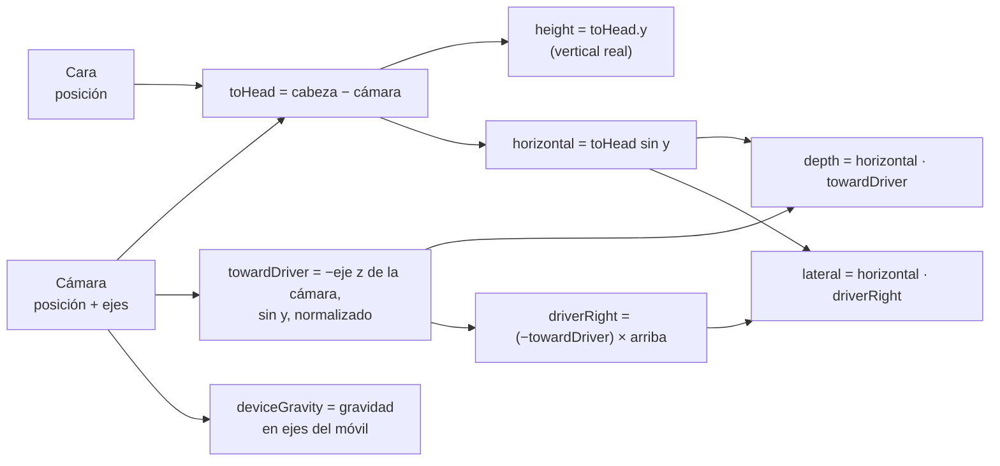
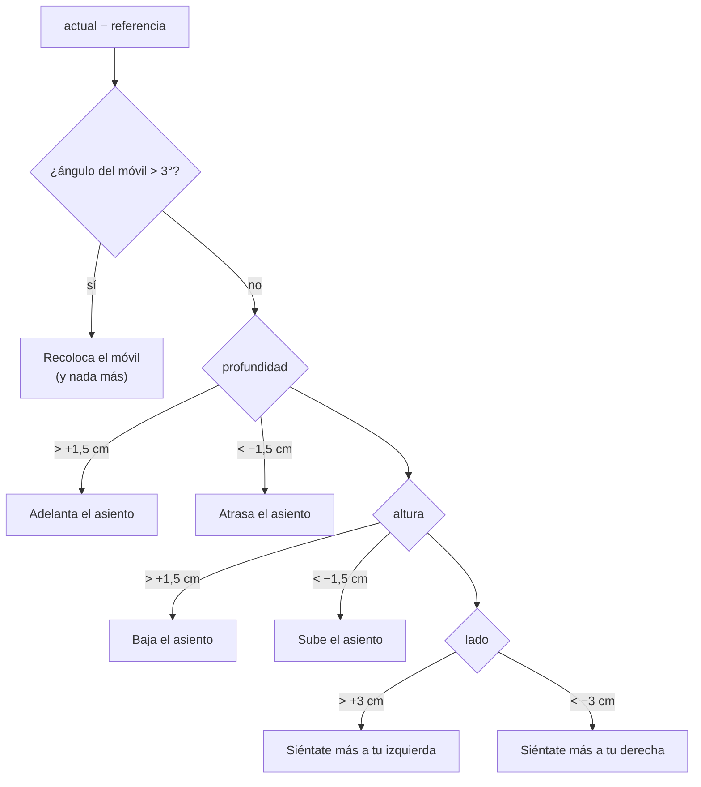

# Cómo funciona la medición

Decisiones: [ADR 0007](adr/0007-arkit-seguimiento-facial.md) y
[ADR 0008](adr/0008-comparacion-en-vivo.md).

## 1. Qué da ARKit

Con `ARFaceTrackingConfiguration` y `worldAlignment = .gravity`, en cada
fotograma ARKit da:

- La **transformación de la cámara** (posición y ejes `x`, `y`, `z`) en un
  "mundo" cuyo eje `y` apunta **contra la gravedad**.
- La **transformación de la cara** (`ARFaceAnchor`), cuyo origen es el centro
  de la cabeza.

## 2. De ARKit a tres distancias (`PostureGeometry`)

- **depth** (profundidad): distancia horizontal de la cámara a la cabeza, en
  la dirección a la que apunta la cámara. Si el asiento va hacia atrás, crece.
- **height** (altura): cuánto más alta está la cabeza que la cámara,
  siguiendo la gravedad. Si el asiento sube, crece.
- **lateral**: desplazamiento horizontal hacia la **derecha del conductor**.
- **deviceGravity**: la gravedad `(0, −1, 0)` vista desde el móvil. No depende
  de la cabeza: si cambia, es que el móvil giró en su soporte.

Como todo se mide contra la gravedad, da igual que el móvil esté en vertical,
en horizontal o algo inclinado: lo que cuenta es que esté **igual** que al
calibrar.

## 3. De muchos fotogramas a una medición (`PostureMeasurement`)

Se usa la **mediana** de cada distancia (y la media normalizada de la
gravedad). Un fotograma raro, como girar la cabeza un instante, no mueve la
mediana.

| Momento | Fotogramas | Cuándo |
| ------- | ---------- | ------ |
| Calibrar | 90 con cara (~1,5 s) | Tras 3 s de cuenta atrás. |
| Comprobar | Ventana de los últimos 30 (~0,5 s) | Continuo, se refresca ~10 veces por segundo. |

## 4. Comparar (`PositionEvaluator`)

Si ninguna regla salta: **Todo en su sitio**.

## 5. Límites

- El móvil es la regla: si el soporte cambia de **sitio** (no solo de
  ángulo), la app no puede saberlo.
- El respaldo mueve la cabeza hacia atrás y abajo a la vez: la app lo
  interpreta como asiento atrasado o bajado y lo avisa en la pista.
- Espejos y volante no se miden: van en las notas.
