# Compilación e instalación (sin Mac)

Igual que DrawPad ([ADR 0004](adr/0004-compilar-sin-mac.md)): GitHub compila,
Sideloadly instala desde Windows.

```mermaid
flowchart LR
    A["Código Swift<br/>+ project.yml"] -->|git push| B["GitHub Actions<br/>(Mac en la nube)"]
    B -->|XcodeGen| C["CarPosition.xcodeproj"]
    C -->|xcodebuild test| D["Pruebas en<br/>simulador de iPhone"]
    D -->|xcodebuild build| E["CarPosition.app<br/>sin firmar"]
    E -->|zip| F["CarPosition-unsigned.ipa<br/>(artefacto)"]
    F -->|descarga| G["PC con Windows<br/>Sideloadly"]
    G -->|firma con tu Apple ID<br/>e instala por USB| H["iPhone"]
```

## Pasos

1. Haz push a una rama (o lanza **Actions → Compilar IPA → Run workflow**).
2. Cuando el workflow termine en verde, descarga el artefacto
   **CarPosition-ipa** y descomprímelo: dentro está
   `CarPosition-unsigned.ipa`.
3. Abre **Sideloadly**, conecta el iPhone por USB, arrastra el `.ipa`, pon tu
   Apple ID y pulsa **Start**.
4. En el iPhone: **Ajustes → General → VPN y gestión de dispositivos** →
   confía en tu Apple ID. Si iOS lo pide, activa el **Modo de desarrollador**
   (Ajustes → Privacidad y seguridad).
5. La primera vez que abras la app, **permite el acceso a la cámara**.

Notas:

- La firma gratuita **caduca a los 7 días**: reinstala con Sideloadly (las
  posiciones guardadas se conservan si instalas encima).
- Con un Apple ID gratuito hay un límite de **3 apps** instaladas así a la
  vez; DrawPad cuenta como una.
- En el simulador del CI no hay cámara: las pruebas de interfaz usan una
  cámara simulada (`-uiTesting`). La medición real se prueba en el auto.
