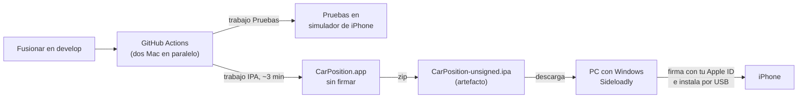

# Compilación e instalación (sin Mac)

Igual que DrawPad ([ADR 0004](adr/0004-compilar-sin-mac.md)): GitHub compila,
Sideloadly instala desde Windows.

## Pasos

1. Fusiona el pull request en `develop`: el trabajo **IPA** genera el `.ipa`
   en unos 3 minutos, sin esperar a las **Pruebas**, que corren en paralelo
   (y ya corrieron en el pull request). Para probar una rama antes de
   fusionarla: **Actions → Compilar IPA → Run workflow** y elige la rama.
2. Cuando termine el trabajo **IPA**, descarga el artefacto
   **CarPosition-ipa** y descomprímelo: dentro está
   `CarPosition-unsigned.ipa`.
3. Abre **Sideloadly**, conecta el iPhone por USB, arrastra el `.ipa`, pon tu
   Apple ID y pulsa **Start**.
4. En el iPhone: **Ajustes → General → VPN y gestión de dispositivos** →
   confía en tu Apple ID. Si iOS lo pide, activa el **Modo de desarrollador**
   (Ajustes → Privacidad y seguridad).
5. La primera vez que abras la app, **permite el acceso a la cámara**.

Notas:

- La firma gratuita **caduca a los 7 días**: reinstala con Sideloadly (las
  posiciones guardadas se conservan si instalas encima).
- Con un Apple ID gratuito hay un límite de **3 apps** instaladas así a la
  vez; DrawPad cuenta como una.
- En el simulador del CI no hay cámaras: las pruebas de interfaz usan
  cámaras simuladas (`-uiTesting`). La realidad aumentada y las medidas
  reales se prueban en el auto.
