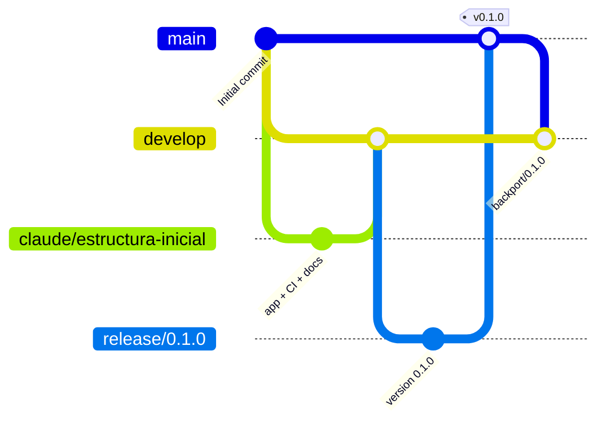

# Flujo de trabajo (Git Flow)

Decisión registrada en [ADR 0002](adr/0002-git-flow.md), adoptada de DrawPad.

| Rama | Sale de | Se fusiona en | Para qué |
| ---- | ------- | ------------- | -------- |
| `main` | — | — | Versiones publicadas. Cada commit es una versión que funcionó en el iPhone. |
| `develop` | `main` | — | Integración: lo próximo que saldrá. |
| `feature/<nombre>` | `develop` | `develop` | Cualquier funcionalidad, arreglo o documentación. |
| `release/<x.y.z>` | `develop` | `main` | Preparar una versión: subir el número. |
| `backport/<x.y.z>` | `main` (tras la release) | `develop` | Llevar a `develop` lo que cambió en la release. |
| `hotfix/<x.y.z>` | `main` | `main` | Arreglo urgente. Después, `backport/<x.y.z>`. |
| `claude/<…>` | — | `develop` (por PR) | Solo sesiones de Claude Code en la nube (excepción del ADR 0002). |

Reglas:

- **Nunca** commits directos en `main` ni en `develop`: siempre por pull
  request, con el workflow **Compilar IPA** en verde.
- **Nunca** un pull request de `develop` a `main`: se pasa por `release/`.

## Versiones

Versionado semántico `x.y.z` en `project.yml` (`MARKETING_VERSION`), que
solo se cambia en ramas `release/` o `hotfix/`. Funcionalidad nueva sube `y`;
solo arreglos, `z`.
