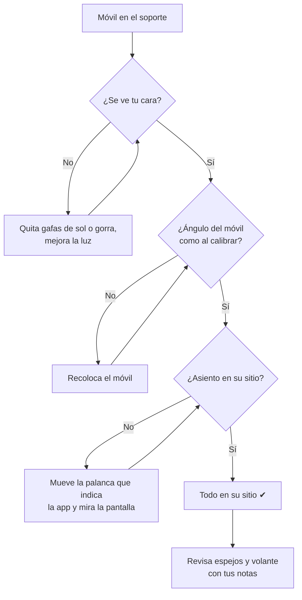

# Uso en el auto

## Lo que necesitas

- Un iPhone con seguimiento facial (XS, XR o posterior).
- **Un soporte fijo** para el móvil: de rejilla, de salpicadero o de
  ventosa. Es la regla de medir: si el soporte cambia de sitio, las medidas
  cambian. Lo ideal es un soporte que se quede siempre en el auto.
- Que la cámara frontal te vea la cara desde el asiento (a unos 50–80 cm).

## Calibrar (una vez)

1. Ajusta todo a tu gusto: asiento, respaldo, volante y espejos.
2. Pon el móvil en el soporte. Anota cómo va (vertical u horizontal, en qué
   rejilla).
3. Abre la app → **+** → escribe un nombre y, en **Notas**, lo que la cámara
   no mide: *"Volante: 2ª muesca hacia arriba. Espejo izquierdo: veo la
   manija de la puerta abajo a la derecha"*.
4. Pulsa **Calibrar**, pon las manos en el volante y mira al frente (hacia el
   parabrisas, con el móvil a la vista). Tras la cuenta atrás, quédate quieto
   un segundo y medio.

## Comprobar (cada vez que te devuelven el auto)

1. Pon el móvil en el soporte **igual que al calibrar**.
2. Abre tu posición. Siéntate con las manos en el volante.
3. Sigue las indicaciones, de arriba abajo. Se actualizan solas mientras
   mueves la palanca:
   - **Recoloca el móvil** → el soporte o el móvil cambiaron de ángulo.
     Arréglalo primero; el resto de consejos aparece después.
   - **Adelanta / atrasa el asiento**.
   - **Sube / baja el asiento**.
   - **Siéntate más a tu izquierda / derecha**.
4. Cuando salga **Todo en su sitio**, revisa la lista de **Revisa también**
   (espejos, volante).

## Consejos

- **El respaldo también cuenta.** Si la app pide adelantar el asiento pero
  el asiento está en su muesca de siempre, probablemente el respaldo está más
  inclinado.
- Siéntate igual que al calibrar: espalda apoyada, manos en el volante.
- Si te cambias el soporte de sitio, vuelve a calibrar (menú **⋯ → Guardar
  posición actual como referencia**).
- Las medidas tienen ±1 cm de margen. Los rieles del asiento van a saltos;
  si queda entre dos muescas, elige la que deje "Todo en su sitio".
- Nunca uses la app manejando: es para ajustar con el auto detenido.
