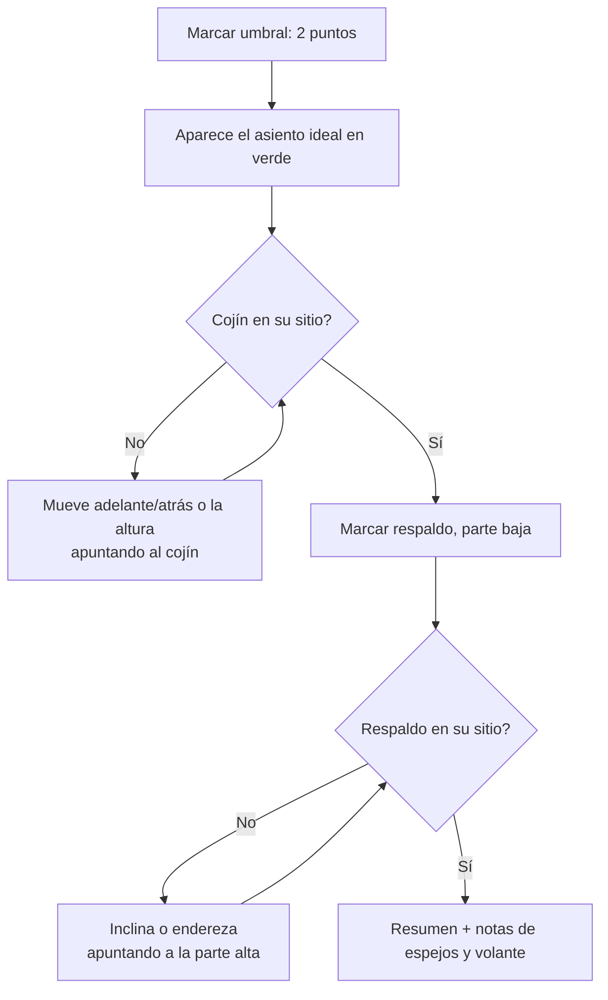

# Uso en el auto

## 1. Guardar tu posición (una vez)

1. Deja todo a tu gusto: asiento, respaldo, volante y espejos.
2. Abre la app → **+**. Se abre la **cámara trasera**. Mueve el móvil
   despacio unos segundos hasta que deje de pedirlo: ARKit está reconociendo
   el auto.
3. Con la puerta del conductor abierta, marca estos puntos con la **mira**
   del centro (cuando la mira se pone verde, pulsa **Marcar**):

| # | Punto | Dónde exactamente |
| - | ----- | ----------------- |
| 1 | Umbral, extremo trasero | El umbral de la puerta, junto al pilar de atrás (B). |
| 2 | Umbral, extremo delantero | El umbral, junto al pilar de delante (A). |
| 3 | Borde delantero del cojín | El centro del borde delantero del asiento. |
| 4 | Respaldo, parte baja | Centro del respaldo, un palmo por encima del cojín. |
| 5 | Respaldo, parte alta | Centro del respaldo, justo debajo del reposacabezas. |

4. Ponle nombre y, en **Notas**, lo que la cámara no mide: *"Volante: 2ª
   muesca. Espejo izquierdo: veo la manija de la puerta abajo a la derecha"*.
5. **Guardar posición.**

> Marca siempre los **mismos** puntos (por ejemplo, una costura o un
> tornillo del umbral). De eso depende la precisión.

## 2. Recuperarla (cada vez que te devuelven el auto)

Abre tu posición → **Ajustar asiento**:

1. **Referencia:** marca otra vez los dos extremos del umbral. Aparece en
   verde, sobre el asiento real, el **asiento ideal**: una bola donde debe
   quedar el borde del cojín y una barra con el ángulo del respaldo.
2. **Cojín:** apunta la mira al borde delantero del cojín. Se dibuja una
   barra naranja hasta la bola verde y la app dice cuánto mover
   (*"Adelanta el asiento unos 3 cm"*, *"Sube el asiento unos 2 cm"*). Mueve
   la palanca con la mira apuntando al cojín hasta que salga **Cojín en su
   sitio**. → **Siguiente: respaldo**.
3. **Respaldo:** marca la parte baja del respaldo y apunta a la parte alta.
   Se dibujan la barra actual (naranja), la ideal (verde) y **el arco del
   ángulo** entre ambas. Inclina o endereza hasta **Respaldo en su sitio**.
4. **Terminar:** resumen y tus notas (espejos, volante).

Si el asiento quedó como te gusta pero distinto del guardado, en el resumen
puedes **Guardar este asiento como ideal**.

## 3. Complemento: comprobar con tu cara (cámara frontal)

Útil si también llevas el móvil en un soporte fijo del auto.

- **Calibrar con mi cara** (una vez): con el asiento ya en su sitio, pon el
  móvil en el soporte, pulsa **Calibrar**, manos al volante y mira al frente.
- **Comprobar con mi cara:** con el móvil en el mismo soporte, te dice si tu
  cabeza quedó más adelante, atrás, arriba o abajo que en la calibración. Si
  el soporte cambió de ángulo, te pide recolocarlo primero.

## Consejos

- Buena luz: ARKit necesita ver texturas. De noche, enciende la luz interior.
- Si la alfombrilla tapa el umbral, apunta a la parte de plástico del umbral,
  no a la alfombrilla.
- Si la guía da números raros, pulsa **Reiniciar** y vuelve a marcar el umbral.
- Con LiDAR (iPhone Pro) la mira es más precisa sobre la tapicería.
- Nunca uses la app manejando: es para ajustar con el auto detenido.
